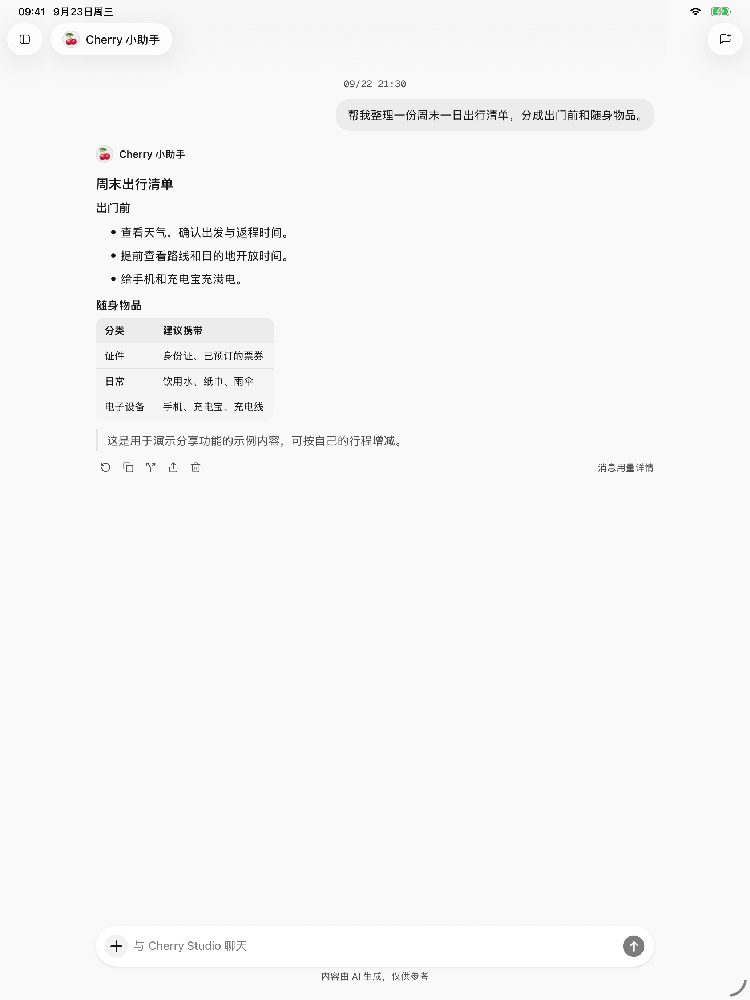

# Cherry Studio 移动版

Cherry Studio 移动版是为 Android、iPhone 与 iPad 设计的 AI 客户端。你可以连接自己的模型服务，在移动设备上进行对话、配置智能体并生成图片。

- **第一次使用**：[快速开始](quick-start.md)，连接模型并发出第一条消息。
- **完成一个任务**：[日常使用](#日常使用)，查找聊天、图片、文件与分享教程。
- **遇到问题**：[常见问题](troubleshooting.md)，按错误提示排查。

<figure data-mobile-shot="phone"><figcaption>
<strong>iPhone</strong> · 完整对话与消息操作，点击查看原图
</figcaption></figure>
<figure data-mobile-shot="tablet"><figcaption>
<strong>iPad</strong> · 针对平板空间展开的对话界面，点击查看原图
</figcaption></figure>

## 当前状态

移动版已上架 Google Play 与 App Store：

* Android 可从 [Google Play](https://play.google.com/store/apps/details?id=com.cherryai.cherrystudio_app) 安装，也保留 APK 下载。
* iPhone 与 iPad 可从 [App Store](https://apps.apple.com/us/app/cherry-studio-app/id6809783714) 安装，也保留 TestFlight 测试版入口。
* 界面与功能可能随版本调整，具体以你安装的版本为准。

前往[下载页的移动端选项](https://cherryai.com.cn/download?platform=mobile)，或先阅读[安装指南](installation.md)。

## 按你现在的需求开始

### 开始使用

[下载与安装](installation.md) · [快速开始](quick-start.md) · [从电脑导入配置](desktop-sync.md)

### 日常使用

[对话与文件](chat-and-files.md) · [联网搜索与网页阅读](web-search.md) · [图片生成](image-generation.md) · [生成与修改文件](file-generation.md) · [HTML 转图片与 PPT](html-export.md) · [分享与导出](sharing-and-export.md)

### 智能体与自动化

[智能体与工具](agents-and-tools.md) · [让 AI 使用工具](using-tools.md) · [日历与提醒事项](calendar-and-reminders.md) · [位置与健康记录](location-and-health.md) · [插件与外部工具](plugins.md)

### 配置与数据

[服务商与模型](providers-and-models.md) · [模型管理](model-management.md) · [模型信息与列表更新](model-updates.md) · [设置、用量与后台回复](settings-and-usage.md) · [数据、隐私与权限](data-privacy.md)

### 故障排查

[常见问题](troubleshooting.md) · [如何高效提问](../question-contact/ask.md) · [反馈问题](../question-contact/suggestions.md)

### 开发者与贡献

[移动版文档贡献与问题报告](development.md)

这些教程覆盖近期移动版功能。旧版本缺少相应入口时，先通过官方渠道更新；截图中的示例名称和模型列表可能与你的配置不同。

> Cherry Studio 是客户端，不附带模型额度。模型调用与已连接服务的费用、使用范围由对应平台决定。
